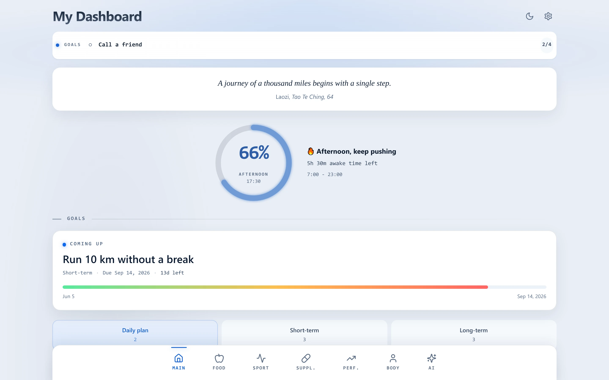
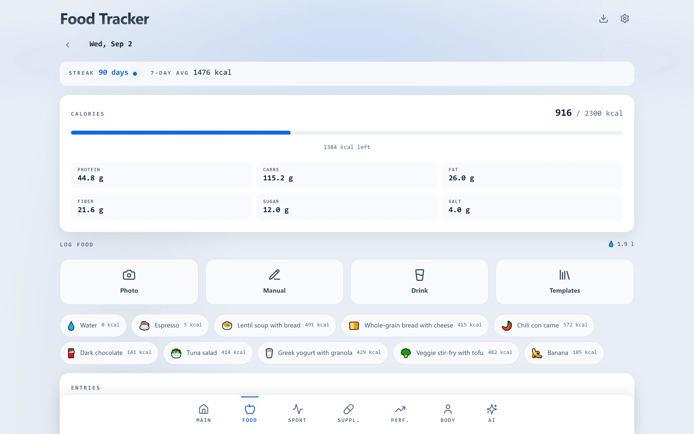
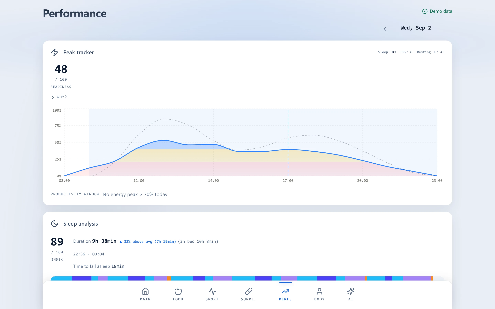
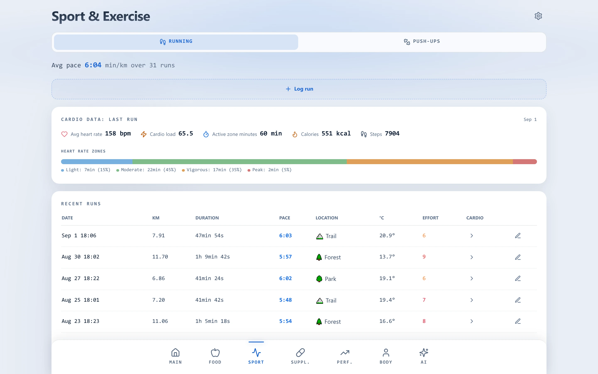
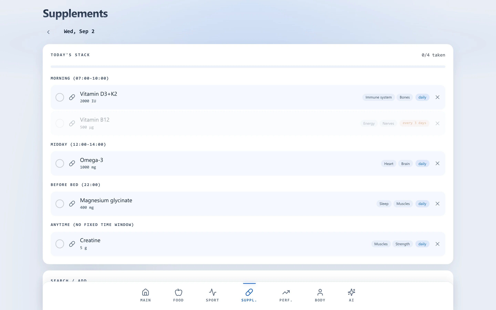
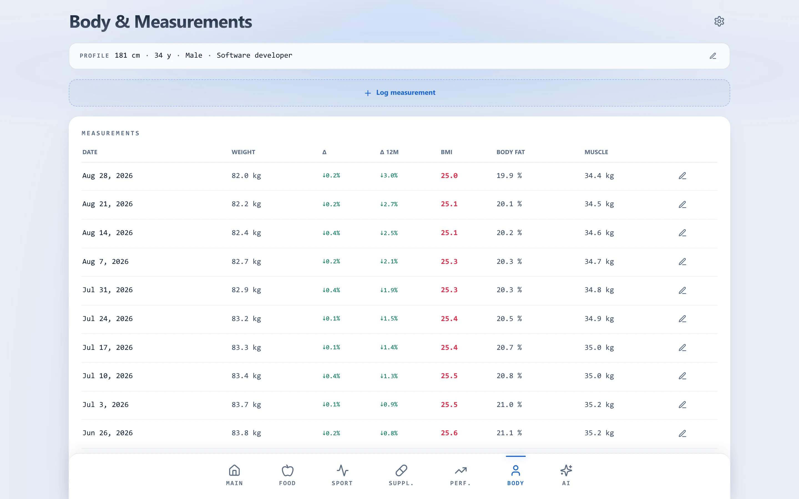
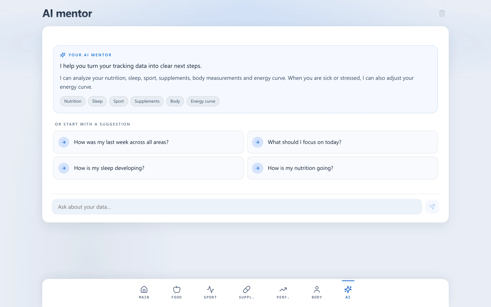
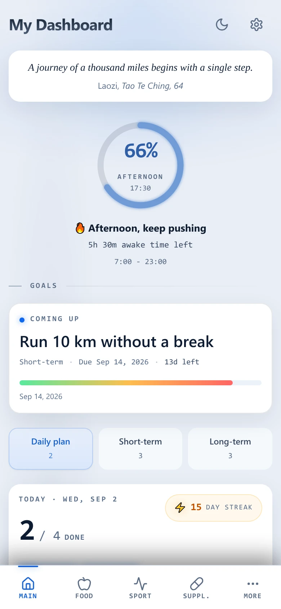
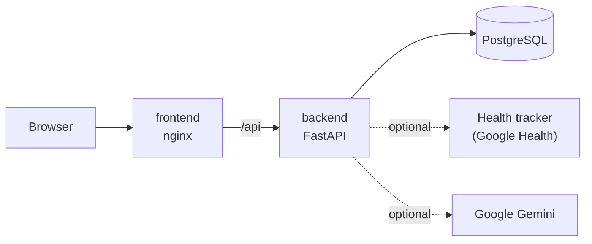

<div align="center">

# Health Habit Starter

**A self-hosted personal health dashboard you clone and make your own, ideally with an AI coding agent.**

[](https://github.com/vinctdev/healthhabitstarter/actions/workflows/ci.yml)
[](LICENSE)
[](https://github.com/vinctdev?tab=packages&repo_name=healthhabitstarter)

<picture>
  <source media="(prefers-color-scheme: dark)" srcset="docs/images/screenshots/main-desktop-dark.webp">
  
</picture>

</div>

## What it is

Health Habit Starter brings habits, goals, nutrition, sport, supplements, sleep, body metrics and an
AI mentor together in one dashboard for **one person: you**. It runs on your own server or
computer, needs no account anywhere, and keeps your data in your own database.

It is meant as a **starting point**, not a finished product. Everyone tracks their health
differently, so the app is built to be changed: areas are registered in one place, the code
follows a few clear conventions, and an AI coding agent can add or remove whole tabs for you.

## Features

- **Main**: daily, short-term and long-term goals with streaks, a day ring showing how much of your
  waking time is left, a daily quote and AI polishing for rough goal notes.
- **Food**: log meals from a photo (AI), by hand with a library of 230+ foods, or from your own
  templates. Calories, macros, water, 7-day averages and a Markdown export.
- **Sport**: runs with pace, effort and heart rate zones from your tracker, plus push-ups per
  variant. New activities plug in as modules.
- **Supplements**: your stack from a library of 38 supplements, grouped by time of day, with
  intervals (e.g. every 3 days) and an intake history.
- **Performance**: readiness score from sleep, HRV and resting heart rate, an energy curve for the
  day that reacts to caffeine, meals and runs, and a sleep analysis with hypnogram.
- **Body**: weight, body fat and muscle mass over time, BMI with zones.
- **AI mentor**: a chat that reads your data through tools and answers questions such as
  *"How did my sleep change since I started running in the evening?"*

Dark and light mode, a dedicated phone layout, metric units. AI features and the fitness tracker
are optional: without them the app works with manual entries.

## Screenshots

<table>
  <tr>
    <td width="50%">
      <picture>
        <source media="(prefers-color-scheme: dark)" srcset="docs/images/screenshots/food-desktop-dark.webp">
        
      </picture>
      <p align="center"><b>Food</b></p>
    </td>
    <td width="50%">
      <picture>
        <source media="(prefers-color-scheme: dark)" srcset="docs/images/screenshots/performance-desktop-dark.webp">
        
      </picture>
      <p align="center"><b>Performance</b></p>
    </td>
  </tr>
  <tr>
    <td>
      <picture>
        <source media="(prefers-color-scheme: dark)" srcset="docs/images/screenshots/sport-desktop-dark.webp">
        
      </picture>
      <p align="center"><b>Sport</b></p>
    </td>
    <td>
      <picture>
        <source media="(prefers-color-scheme: dark)" srcset="docs/images/screenshots/supplements-desktop-dark.webp">
        
      </picture>
      <p align="center"><b>Supplements</b></p>
    </td>
  </tr>
  <tr>
    <td>
      <picture>
        <source media="(prefers-color-scheme: dark)" srcset="docs/images/screenshots/body-desktop-dark.webp">
        
      </picture>
      <p align="center"><b>Body</b></p>
    </td>
    <td>
      <picture>
        <source media="(prefers-color-scheme: dark)" srcset="docs/images/screenshots/ai-desktop-dark.webp">
        
      </picture>
      <p align="center"><b>AI mentor</b></p>
    </td>
  </tr>
</table>

<p align="center">
  <picture>
    <source media="(prefers-color-scheme: dark)" srcset="docs/images/screenshots/main-mobile-dark.webp">
    
  </picture>
  <br><b>On your phone</b>
</p>

## Quick start

You need Docker with Compose.

```bash
git clone https://github.com/vinctdev/healthhabitstarter.git
cd healthhabitstarter
cp .env.example .env          # set DB_PASSWORD (e.g. `openssl rand -hex 32`) and TZ
docker compose pull && docker compose up -d
```

Open <http://localhost:8080>.

**Try it with demo data:** set `HEALTH_PROVIDER=demo` in `.env` (generated tracker data, no
fitness tracker needed), run `docker compose up -d`, then fill the empty database with about 90 days
of sample entries:

```bash
docker compose exec -e ENVIRONMENT=development backend python -m app.demo_seed
```

The seeder refuses to run when the database already contains data, so it cannot overwrite your
own entries by accident.

> [!IMPORTANT]
> The app has **no login**. It is only reachable from the machine it runs on, and should stay
> that way. To use it from your phone, put it behind a VPN or a reverse proxy with
> authentication: see [Securing access](docs/deployment.md#securing-access).

Updates, backups and all settings: [docs/deployment.md](docs/deployment.md).

## Make it yours (with AI)

[`CLAUDE.md`](CLAUDE.md) describes the architecture and conventions for AI coding agents
(Claude Code, Codex, Cursor, ...), so you can ask for changes in plain words:

> Remove the Supplements tab from the app. Follow `docs/customizing.md`, do a thorough cleanup
> (view files, router, AI mentor tool, demo data) but keep the database tables.

> Add a "Cycling" module to the Sport tab, modelled on the push-up module: rides with date,
> distance (km), duration and elevation gain (m). Include the backend model, migration, router,
> frontend module, demo data and a read-only tool for the AI mentor. Follow `docs/customizing.md`.

> In the readiness score, weight HRV higher than sleep. Update `docs/energy-model.md` and the
> tests in `backend/tests/test_readiness.py`.

More in [docs/customizing.md](docs/customizing.md).

## How it works



A React app served by nginx, a FastAPI backend that owns all data and calculations, and a
PostgreSQL database, started together with Docker Compose. Tracker data is cached in the
database, so your history stays available when the tracker's API is not. Details: [docs/architecture.md](docs/architecture.md).

## Integrations

- **Fitbit and Pixel Watch** through the Google Health API: sleep, HRV, resting heart rate, SpO₂,
  steps and run cardio data. Setup: [docs/google-health.md](docs/google-health.md).
- **Your own tracker** (Whoop, Garmin, Oura, ...): implement one provider class.
  Guide: [docs/adding-a-health-provider.md](docs/adding-a-health-provider.md).
- **Google Gemini** for the AI features, usable with a free API key.
  Setup and privacy notes: [docs/gemini.md](docs/gemini.md).

## Documentation

| Document | Contents |
|----------|----------|
| [deployment.md](docs/deployment.md) | Installation, configuration, securing access, updates, backups |
| [customizing.md](docs/customizing.md) | Adding and removing tabs and sports, prompts for AI agents |
| [architecture.md](docs/architecture.md) | How frontend, backend, database and integrations fit together |
| [development.md](docs/development.md) | Local setup, checks, migrations, screenshots |
| [energy-model.md](docs/energy-model.md) | How readiness and the energy curve are calculated |
| [google-health.md](docs/google-health.md) | Connecting a Fitbit or Pixel Watch |
| [adding-a-health-provider.md](docs/adding-a-health-provider.md) | Connecting another tracker |
| [gemini.md](docs/gemini.md) | AI features: API key, models, limits, privacy |

## Tech stack

| Area | Technology |
|------|------------|
| Frontend | React 19, TypeScript, Vite, Tailwind CSS, TanStack Query, Recharts |
| Backend | Python, FastAPI, SQLAlchemy, Alembic |
| Database | PostgreSQL (SQLite for local development) |
| Deployment | Docker Compose, multi-arch images (amd64, arm64) on GitHub Container Registry |
| Quality | pytest, Ruff, ESLint, Prettier, GitHub Actions |

## Privacy and disclaimer

Your data stays in your database. Nothing leaves your server unless you enable an integration:
the tracker integration reads from your tracker's API, and the AI features send the data they
need to Google Gemini ([what exactly is sent](docs/gemini.md#privacy-what-is-sent-to-google)).

Health Habit Starter is a personal tracking tool, **not a medical device**. Its scores, curves and
AI answers are not medical advice.

## License

[Unlicense](LICENSE): public domain. Use, change and share it however you like.
