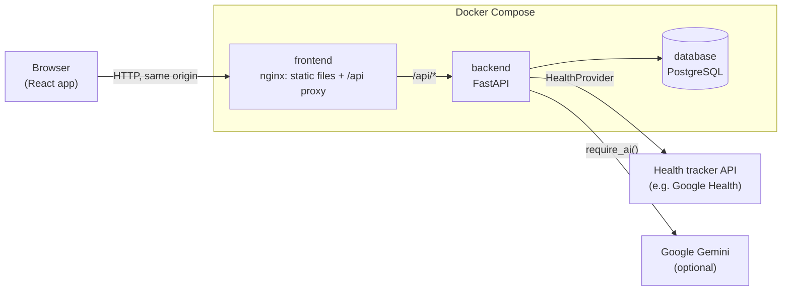
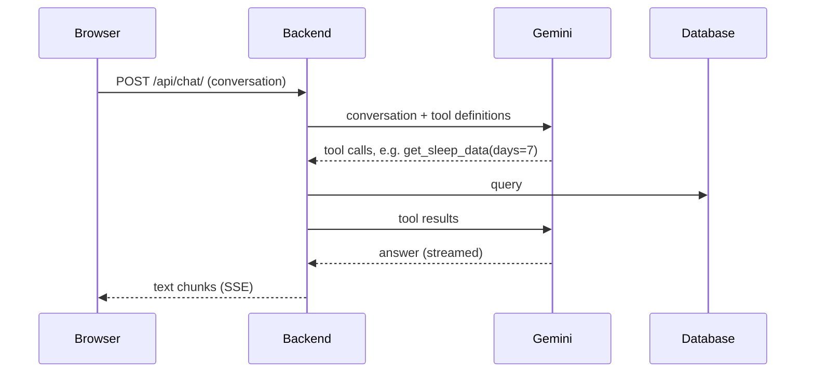

# Architecture

Health Habit Starter is a single-user web app: a React frontend, a FastAPI backend and a
PostgreSQL database (SQLite in local development). Health trackers and Google Gemini are optional
external services behind small, swappable interfaces.

This page explains how the parts fit together. For changing the app see
[customizing.md](customizing.md), for running it [deployment.md](deployment.md) and
[development.md](development.md).

## Overview



- The browser only talks to one origin. nginx serves the built frontend and forwards `/api/*` to
  the backend; in development the Vite dev server does the same. The API therefore needs no CORS,
  and has none on purpose: the app has no login, so other websites must not be able to read it.
- The backend owns all data and all calculations (streaks, sleep index, readiness, energy curve).
  The frontend renders what the API returns.
- Data from trackers is cached in the database, so the app keeps working when the tracker API is
  slow or down, and history stays available after switching trackers.

## Repository layout

```
backend/app/
  main.py              FastAPI app, router registration, library seeding on startup
  config.py            settings from environment variables / .env
  models.py            all SQLAlchemy models
  routers/             one router per area (goals, food, runs, pushups, supplements, ...)
  schemas/             Pydantic request/response models per area
  health_providers/    tracker integrations behind one interface
  gemini_client.py     Gemini client (streaming, tool calling)
  demo_seed.py         reproducible demo data
backend/alembic/       database migrations
backend/tests/         pytest suite
frontend/src/
  features.ts          tab registry
  components/          desktop views (one *View.tsx per tab) and widgets
  components/sport/    sport modules, registered in sportModules.ts
  mobile/              phone shell and views (< 640 px)
  api/  hooks/         fetch functions and TanStack Query hooks per area
  theme/  utils/  types/
```

## Frontend

### Tabs are defined in one place

`features.ts` holds the list of tabs. The navigation on desktop and phone is built from that list,
so no other file needs to know which tabs exist. The Sport tab does the same with
`components/sport/sportModules.ts`. Adding or removing an area means adding or removing one entry
([customizing.md](customizing.md)).

### How data gets from the API to the screen

Every area uses the same three layers:

```
api/<area>.ts            plain fetch functions, typed with types/
  → hooks/use<Area>.ts   TanStack Query hooks: caching, refetching, invalidation after changes
    → component          renders data, calls mutations
```

Components never call `fetch` directly. When you save something, the hooks reload the data that
changed, so every view showing it updates at once.

### Phone and desktop

On screens narrower than 640 px, `AppShell` switches to a separate phone layout (`mobile/`) with
its own navigation, cards instead of tables, and bottom sheets. A tab can bring its own phone view
(`mobileView` in `features.ts`); otherwise its desktop view is used on phones too.

### Look and feel

Colors, spacing and fonts are CSS variables (`--ui-*` in `index.css`), with dark mode as the
default and a light mode. Text uses the system sans font, numbers a monospace font
(`theme/typography.ts` decides which). Icons come from Lucide via `react-icons/lu`.

## Backend

### One router per area

Each area (goals, food, runs, ...) has its API endpoints in a router in `routers/`, registered in
`main.py`, and its request and response models in `schemas/`. The logic lives next to the router
that uses it; there is no separate service layer.

### Database

All models are in `models.py`. Changes to the tables go through Alembic migrations, which run
automatically when the container starts. On startup the backend also loads two built-in libraries
into the database: known foods (with emojis and nutrients) and supplements.

| Area | Tables |
|------|--------|
| Goals | `goals`, `streaks`, `user_settings` |
| Food | `food_entries`, `food_templates`, `food_streaks`, `known_foods` (library) |
| Sport | `runs`, `run_cardio`, `pushup_entries` |
| Supplements | `user_supplements`, `supplement_logs`, `supplements` (library) |
| Performance | `sleep_sessions`, `daily_metrics`, `energy_adjustments` |
| Body | `body_profile`, `body_measurements` |

### Tracker data

Routers get tracker data only through `get_health_provider()`, which returns the provider selected
by `HEALTH_PROVIDER` (`google`, `demo`, `none`). A provider returns plain data classes
(`health_providers/base.py`), and the routers store them:

- Sleep and run cardio data are fetched once per night or run and then served from the database.
- Today's daily metrics (resting heart rate, HRV, SpO₂, steps) are refreshed after 30 minutes;
  past days come from the database.

New trackers are a new provider class, see
[adding-a-health-provider.md](adding-a-health-provider.md).

## Rules that apply everywhere

- **A day starts at 04:00, not at midnight** (configurable, `user_settings.day_start_hour`), so a
  late dinner still counts for the evening it belongs to. The backend uses `get_active_date()`,
  the frontend `getActiveDate()`; nothing uses the calendar date directly.
- **Tracker times are stored in UTC**, without a time zone. The backend converts them with the
  `TZ` environment variable, the frontend with the browser's time zone.
- **Unknown is not zero.** Optional nutrients (e.g. fiber) are `NULL` when unknown and `0` only
  when measured as zero. Sums and AI tools report how many entries had a value.
- **Metric units only** (kg, cm, km, °C, kcal, ml). There is no conversion layer.

## AI features

All AI features use Google Gemini and are optional. Without `GEMINI_API_KEY`, the AI endpoints
answer `503` (`require_ai()`), and the frontend greys out the AI buttons (`useAiEnabled()`).

| Feature | Endpoint |
|---------|----------|
| Photo to nutrition | `POST /api/food/analyze-photo` |
| Nutrition suggestion | `POST /api/food/suggest-nutrition` |
| Goal polishing | `POST /api/goals/polish` |
| AI mentor | `POST /api/chat/` |

The **AI mentor** is a chat with tool calling. The backend gives Gemini a set of tools
(`TOOLS` in `routers/chat.py`) that read your data on demand, and streams the answer to the
browser as server-sent events:



- All tools are read-only except `adjust_energy_curve`: when you mention being ill, stressed or
  especially fit, the mentor can lower or raise the energy curve of a day (saved and shown as an
  influence in the Performance tab).
- At most 7 rounds of tool calls per message keep a confused model from looping.
- The conversation lives only in the browser tab and is not stored by the backend.

What each feature sends to Google and the free tier limits are in [gemini.md](gemini.md). How readiness and the
energy curve are calculated is in [energy-model.md](energy-model.md).
